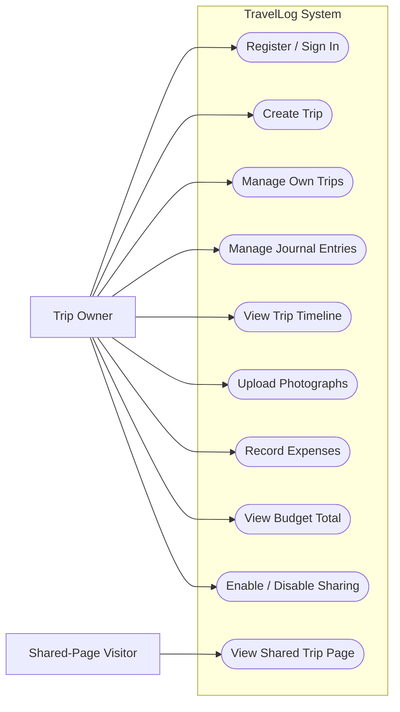

# TravelLog — Requirements Analysis & Project Plan
*Trip Journal and Sharing Platform*

**Module:** B9IS130 – Web Development for Information Systems  
**Assessment:** Continuous Assessment 1 – Individual Project  
**Technology Stack:** MERN (MongoDB | Express.js | React | Node.js)  
**Version:** 1.0 | Initial Requirements Baseline

---

> [!IMPORTANT]
> **Document Status:** This document is a project-specific requirements analysis and plan prepared against the B9IS130 CA1 assessment brief. Before submission, verify the university's required formatting, add identifying details, conduct and report any research actually completed, and revise statements to reflect decisions and evidence from the implemented system. Proposed targets and assumptions are not presented as measured results. Any AI assistance must be acknowledged in accordance with the module's rules.

### Document Control

| Version | Date | Status | Description |
| :---: | :--- | :--- | :--- |
| 1.0 | 06 November 2026 | Draft baseline | Initial requirements analysis, scope, use cases, data model, and five-day plan. |

---

## Table of Contents

1. [Introduction](#1-introduction)
2. [Problem Statement](#2-problem-statement)
3. [Project Aim and Objectives](#3-project-aim-and-objectives)
4. [Problem Domain and Stakeholders](#4-problem-domain-and-stakeholders)
5. [Research and Existing-System Review Plan](#5-research-and-existing-system-review-plan)
6. [Functional Requirements](#6-functional-requirements)
7. [Non-Functional Requirements](#7-non-functional-requirements)
8. [Scope and Constraints](#8-scope-and-constraints)
9. [Feasibility Analysis](#9-feasibility-analysis)
10. [User Stories and Acceptance Criteria](#10-user-stories-and-acceptance-criteria)
11. [Use-Case Model](#11-use-case-model)
12. [Proposed System Architecture](#12-proposed-system-architecture)
13. [Data Model](#13-data-model)
14. [Security and Privacy Analysis](#14-security-and-privacy-analysis)
15. [Development Methodology and Five-Day Plan](#15-development-methodology-and-five-day-plan)
16. [Requirements Traceability and Verification Plan](#16-requirements-traceability-and-verification-plan)
17. [Risks and Mitigation](#17-risks-and-mitigation)
18. [Expected Deliverables and Conclusion](#18-expected-deliverables-and-conclusion)
- [References](#references)
- [Appendix A: Use-Case Diagram Source](#appendix-a-use-case-diagram-source)
- [Appendix B: Initial API Endpoint Proposal](#appendix-b-initial-api-endpoint-proposal)

---

## 1. Introduction

TravelLog is a web-based trip journaling application intended to help travelers organize and preserve travel experiences. The proposed system enables registered users to create trips, document experiences through dated journal entries, record places visited, upload photographs, and track trip expenses. Its distinguishing feature is a **chronological trip timeline** that brings a trip's entries together in a structured view. A trip owner may also enable sharing to provide a read-only public page to friends or family.

The application is proposed as a full-stack JavaScript system using the **MERN stack**: MongoDB for persistence, Express.js and Node.js for the backend REST API, and React for the user interface. The initial version prioritizes core functionality, security, understandable implementation, and deployability. Features such as collaborative editing, live maps, booking integrations, and AI-generated itineraries are excluded from the first release.

This requirements analysis is based on the B9IS130 CA1 assessment brief and project decisions made for TravelLog. The brief identifies requirements analysis, user experience, backend/database functionality, API integration, security, software engineering, and deployment as relevant assessment areas.

---

## 2. Problem Statement

Travelers may record their experiences using a combination of photographs, notes, maps, social media posts, and separate budgeting tools. Information about one trip can consequently become fragmented, making it difficult to reconstruct a journey chronologically, preserve travel memories, and review spending.

TravelLog proposes a centralized web-based trip journal where users can create and manage trips, document experiences through dated entries, organize photographs and places, and record expenses. A chronological timeline will present the trip as an organized travel story, while owner-controlled sharing will allow selected trip information to be viewed by others.

> [!NOTE]
> This problem statement is an initial hypothesis and should be evaluated through research with potential users and a review of comparable systems.

---

## 3. Project Aim and Objectives

### 3.1 Aim

To design, develop, test, and deploy TravelLog — a responsive MERN-based web application that enables travelers to document trips through journal entries, places, photographs, and expenses, while presenting experiences through a chronological timeline and owner-controlled shareable pages.

### 3.2 Objectives

1. Investigate the needs of travelers who want to preserve and organize travel experiences.
2. Identify and document functional and non-functional requirements for a digital trip journal.
3. Design a responsive and accessible interface for trips, journal entries, photographs, and expenses.
4. Implement a RESTful backend using Node.js and Express.js, supported by MongoDB.
5. Develop a chronological timeline that organizes journal entries by date.
6. Implement owner-controlled sharing with public read-only access to selected trip information.
7. Apply authentication, authorization, input validation, and privacy controls.
8. Test the application against documented requirements and deploy a working version.

---

## 4. Problem Domain and Stakeholders

The problem domain is **personal travel documentation and trip journaling**. The system supports travelers who want to preserve their experiences in a structured format. The first release uses two application roles: **Trip Owner** and **Shared-Page Visitor**.

| Stakeholder / Actor | Description | Needs / Interests |
| :--- | :--- | :--- |
| **Trip Owner** | Authenticated user who owns trips. | Create and manage trips; record places, notes, photos, and expenses; view a timeline; control sharing. |
| **Shared-Page Visitor** | Person opening an explicitly shared trip URL. | View permitted trip content without an account; cannot edit or access private trips. |
| **Project Developer** | Student responsible for design, implementation, testing, security, and deployment. | Maintain manageable scope; produce understandable code; verify requirements. |
| **Assessment Marker** | Evaluates the submission against the module brief. | Evidence of requirements, implementation quality, security, testing, deployment, and student understanding. |
| **Potential Travelers** | People who may provide exploratory feedback. | A useful, clear, and privacy-conscious way to record travel experiences. |

> [!NOTE]
> An administrator role, social network features, and collaborative editing are **not** included in the first version. This limits implementation complexity while retaining the essential user journeys.

---

## 5. Research and Existing-System Review Plan

Research will investigate how travelers currently preserve and share experiences and whether a structured chronological journal addresses a relevant need.

### 5.1 Research Questions

1. How do travelers currently record trips and preserve memories?
2. What information do users want to keep together for a trip?
3. Is a chronological timeline useful for revisiting travel experiences?
4. What information should be visible on a shared trip page?
5. What privacy concerns arise from sharing photographs, dates, and places?
6. What technical constraints may affect image storage and deployment?

### 5.2 Proposed Research Method

A small exploratory investigation may be conducted through a short questionnaire or informal interviews with potential users. Responses should be recorded accurately and summarized without overstating the representativeness of a small sample. A desk-based review should compare relevant travel-journaling, photo-sharing, or expense-tracking products against a common set of features:
- Trip organization
- Chronological presentation
- Expense tracking
- Sharing controls

> [!NOTE]
> The proposed contribution is the integration of these essential functions into one trip journal. This is a proposed differentiation, not a verified market gap until the comparison is completed.

---

## 6. Functional Requirements

Functional requirements specify system behavior. IDs are assigned to support traceability between requirements, implementation, and verification.

**Priority Definitions:**
- **Must:** Core first-version / minimum viable release functionality.
- **Should:** Secondary — may be omitted if the time constraint requires it.

### Requirements Table

| ID | Functional Requirement | Priority |
| :--- | :--- | :---: |
| **FR-01** | The system shall allow a visitor to register for an account using valid registration information. | `Must` |
| **FR-02** | The system shall allow a registered user to sign in and sign out. | `Must` |
| **FR-03** | The system shall allow an authenticated user to create a trip with a title, destination, start date, and end date. | `Must` |
| **FR-04** | The system shall allow a trip owner to view, update, and delete their own trips. | `Must` |
| **FR-05** | The system shall allow a trip owner to create a dated journal entry containing a title, place, and notes. | `Must` |
| **FR-06** | The system shall allow a trip owner to view, update, and delete their own journal entries. | `Must` |
| **FR-07** | The system shall display a trip's journal entries in chronological order by entry date. | `Must` |
| **FR-08** | The system shall allow a trip owner to upload photographs and associate them with a trip or journal entry. | `Must` |
| **FR-09** | The system shall allow a trip owner to record an expense with amount, currency, date, category, and description. | `Must` |
| **FR-10** | The system shall display recorded expenses and calculate the total recorded trip spending. | `Must` |
| **FR-11** | The system shall allow a trip owner to enable or disable sharing for a trip. | `Must` |
| **FR-12** | The system shall provide a shareable URL when sharing is enabled for a trip. | `Must` |
| **FR-13** | The system shall allow a visitor to view a shared trip page without signing in. | `Must` |
| **FR-14** | The system shall prevent visitors from viewing trips that are private or not shared. | `Must` |
| **FR-15** | The system shall provide a read-only shared page that excludes budget and expense information. | `Must` |
| **FR-16** | The system should allow a trip owner to search or filter trips by title or destination. | `Should` |

### 6.1 Requirement Clarifications

- The timeline will display entry date, place, notes, and associated photographs in chronological order.
- Budget functionality is limited to recording expenses and calculating totals; live currency conversion is excluded.
- Sharing is **disabled by default** and requires an explicit owner action.
- A shared page is **read-only** and excludes expense and budget data.
- The owner can disable sharing, after which the public URL must no longer return the shared content.

---

## 7. Non-Functional Requirements

Non-functional requirements define system quality attributes. Quantitative targets are proposed objectives and must be evaluated under stated test conditions; they are not claimed as achieved results.

| ID | Attribute | Requirement |
| :--- | :--- | :--- |
| **NFR-01** | Security | The backend shall enforce ownership checks for private trip and journal operations. |
| **NFR-02** | Privacy | Trips shall be private by default; sharing requires an explicit owner action. |
| **NFR-03** | Performance | Under project test conditions, the main trip list and trip detail pages should load within 3 seconds for 95% of requests. |
| **NFR-04** | Usability | Core trip creation and journal-entry workflows shall use clear labels, predictable navigation, and understandable feedback. |
| **NFR-05** | Responsiveness | The interface shall provide usable layouts on mobile, tablet, and desktop screen sizes. |
| **NFR-06** | Accessibility | Forms and interactive controls shall provide labels, keyboard support, semantic structure, and sufficient contrast. |
| **NFR-07** | Reliability | Failed requests shall produce meaningful feedback rather than silently failing. |
| **NFR-08** | Maintainability | The codebase shall separate frontend components, API routes, controllers, validation, and data models. |
| **NFR-09** | Data Validation | The backend shall validate incoming data, including required fields, dates, and expense amounts. |
| **NFR-10** | Deployment | The deployed application shall use environment variables and shall not expose secrets in client-side code or the repository. |

> [!NOTE]
> **Performance Target Note:** The 3-second load time target is a proposed project benchmark for testing, rather than an already measured metric. Actual response times will be tested, evaluated, and reported during project verification.

---

## 8. Scope and Constraints

### 8.1 In Scope

- Registration, sign-in, and sign-out.
- Trip creation, viewing, updating, and deletion.
- Trip title, destination, and dates.
- Dated journal entries with places and notes.
- Photograph uploads and image references.
- Chronological trip timeline.
- Expense recording and total spending calculation.
- Private trips and owner-controlled sharing.
- Public read-only shared pages that exclude expenses.
- Responsive interface, backend validation, authorization, REST API, testing, and deployment.

### 8.2 Out of Scope

- Live maps, GPS tracking, and route planning.
- Flight, hotel, or other booking integrations.
- Live currency conversion.
- Collaborative trip editing.
- Comments, likes, followers, and messaging.
- AI-generated itineraries or summaries.
- Native mobile applications and advanced analytics.

### 8.3 Constraints

- The project is an individual academic assignment with a five-day remaining development window.
- The implementation must remain understandable to the student for the demonstration and viva-style questions.
- Hosting and file storage may be constrained by free-tier limits.
- The project must comply with the assessment brief, submission requirements, and academic integrity / AI-use rules.

---

## 9. Feasibility Analysis

| Feasibility Area | Initial Assessment |
| :--- | :--- |
| **Technical** | MERN supports the React UI, REST API, and MongoDB persistence. Authentication, authorization, image storage, and deployment are the main technical risks. |
| **Economic** | The prototype will prioritize free or student-accessible tools. Hosting and storage limits or charges must be checked before final selection. |
| **Operational** | The core workflows are familiar to travelers. Usability assumptions should be checked through exploratory feedback. |
| **Schedule** | The five-day plan is aggressive. Scope is restricted to essential features; deployment and testing must begin before the final day. |
| **Privacy / Legal** | Trip photos and location details may be personal. Public sharing must be opt-in, read-only, and limited to intended fields. |

> [!NOTE]
> Feasibility is provisional. The selected hosting and image-storage services, their limits, and the actual delivery progress should be recorded as implementation decisions are made.

---

## 10. User Stories and Acceptance Criteria

### US-01: Create a Trip
> **As a** registered traveler,  
> **I want to** create a trip with a destination and dates,  
> **So that** I can organize my travel memories in one place.

**Acceptance Criteria:**
- A signed-in user can open the create-trip form.
- Title, destination, start date, and end date are required.
- The end date cannot be earlier than the start date.
- The saved trip appears in the owner's trip list.
- The trip is private by default.

### US-02: Add a Journal Entry
> **As a** trip owner,  
> **I want to** add a dated entry with a place, notes, and photographs,  
> **So that** I can preserve my travel experiences.

**Acceptance Criteria:**
- The owner can add an entry to a trip they own.
- The entry includes a date, place, and notes.
- The owner can attach photographs.
- The entry appears on the timeline in chronological order.
- The owner can edit or delete the entry.

### US-03: Share a Trip
> **As a** trip owner,  
> **I want to** enable sharing and receive a URL,  
> **So that** friends and family can view my travel story.

**Acceptance Criteria:**
- Sharing is disabled by default.
- The owner can enable sharing and obtain a URL.
- A visitor can view the shared page without signing in.
- A visitor cannot edit the trip.
- The shared page excludes budget and expense information.
- Disabling sharing makes the public page unavailable.

### US-04: Record Expenses
> **As a** trip owner,  
> **I want to** record expenses for a trip,  
> **So that** I can review recorded spending.

**Acceptance Criteria:**
- An expense includes amount, date, category, currency, and description.
- The amount must be greater than zero and valid.
- The expense is associated with the correct trip.
- The trip total reflects the recorded expenses.
- Expense data is not returned by the public shared-page endpoint.

> [!NOTE]
> **Traceability Note:** These user stories directly translate into frontend interfaces, backend endpoints, and verification test cases in subsequent development phases.

---

## 11. Use-Case Model

The primary actors are **Trip Owner** and **Shared-Page Visitor**. The owner must authenticate to manage private data. A visitor can view only trips whose owner has enabled sharing.

| Use Case ID | Use Case | Actor |
| :---: | :--- | :--- |
| **UC-01** | Register account | Visitor |
| **UC-02** | Sign in | Registered traveler |
| **UC-03** | Create trip | Registered traveler |
| **UC-04** | Manage own trips | Trip owner |
| **UC-05** | Add and manage journal entries | Trip owner |
| **UC-06** | View trip timeline | Trip owner |
| **UC-07** | Upload photographs | Trip owner |
| **UC-08** | Record and review expenses | Trip owner |
| **UC-09** | Enable or disable sharing | Trip owner |
| **UC-10** | View shared trip page | Shared-page visitor |

### 11.1 Use Case: View Shared Trip

| Item | Description |
| :--- | :--- |
| **Primary Actor** | Shared-page visitor |
| **Precondition** | The trip owner has enabled sharing. |
| **Trigger** | The visitor opens the shareable URL. |
| **Main Flow** | 1. Visitor opens URL. 2. Server identifies the trip. 3. Server verifies sharing is enabled. 4. Server returns permitted public fields. 5. UI displays timeline, places, notes, dates, and photographs. |
| **Alternative Flow** | If the trip does not exist or sharing is disabled, show an unavailable response. Attempts to modify the trip are rejected. |
| **Postcondition** | The visitor has viewed only the information permitted for public sharing. |

---

## 12. Proposed System Architecture

TravelLog will use a **client-server architecture**. The React frontend will communicate with the Express.js REST API over HTTP, using JSON for ordinary data exchange. The backend will authenticate users, validate requests, enforce authorization, and read or write MongoDB data. Photograph binaries will be stored using a suitable file-storage service; MongoDB will store the associated file references and metadata.

| Layer | Responsibility | Proposed Components |
| :--- | :--- | :--- |
| **Presentation** | User workflows and responsive pages | React; registration/sign-in; dashboard; trip details; timeline; expenses; sharing; public page |
| **API / Application** | Request handling, validation, authentication, authorization, business rules | Node.js; Express.js; route/controller separation; middleware |
| **Persistence** | Store and retrieve application records | MongoDB collections for users, trips, journal entries, and expenses |
| **Image Storage** | Store uploaded image files and serve permitted image references | Selected upload/storage provider; service choice to be verified against limits and deployment needs |
| **Deployment** | Host frontend and backend; configure runtime secrets | Cloud deployment provider(s) to be selected and verified |

> [!TIP]
> The API will be documented in the project README. Frontend workflows should include loading, success, empty, and error states.

---

## 13. Data Model

The initial data model uses **four main MongoDB collections**. This model intentionally avoids separate collections for social features, places, or collaboration because those functions are outside the first release.

| Collection | Key Fields | Purpose / Relationship |
| :--- | :--- | :--- |
| **users** | `_id, name, email, passwordHash, createdAt` | Registered account; email should be unique. Password stored only as a hash. |
| **trips** | `_id, ownerId, title, destination, startDate, endDate, isShared, shareToken, createdAt, updatedAt` | Trip belongs to one owner; sharing is disabled by default. |
| **journalEntries** | `_id, tripId, title, place, notes, entryDate, photos, createdAt, updatedAt` | Entries belong to a trip and are sorted by `entryDate`. |
| **expenses** | `_id, tripId, description, category, amount, currency, expenseDate, createdAt` | Expenses belong to a trip and contribute to its total. |

### 13.1 Relationship Summary

- One **user** may own many **trips**.
- One **trip** may contain many **journal entries**.
- One **trip** may contain many **expenses**.
- Journal entries and expenses refer to their parent trip.
- Photographs are stored as external file objects; the database stores URLs or storage identifiers and metadata.

### 13.2 Data Access Rule

> [!CAUTION]
> A trip identifier does **not** establish ownership. For protected operations, the backend must verify that the authenticated user owns the trip before returning or modifying it. Journal-entry and expense access must be checked through the parent trip. Public endpoints must query only shared trips and return an allow-listed set of public fields; they must **not** return expense records or internal ownership and sharing fields.

---

## 14. Security and Privacy Analysis

TravelLog may contain personal notes, photographs, dates, and location information. Security and privacy are therefore treated as core requirements. The assessment brief highlights security awareness, including common web application risks.

| Concern | Measure |
| :--- | :--- |
| **Password storage** | Use a secure password-hashing algorithm; never store plaintext passwords. |
| **Authentication** | Protect private operations with authenticated requests and an appropriately configured session or token approach. |
| **Authorization** | Check ownership on every protected trip, journal-entry, and expense operation. |
| **Input validation** | Validate required fields, dates, numeric amounts, and permitted values on the backend. |
| **Injection protection** | Use safe database access patterns and avoid constructing unsafe database queries from raw input. |
| **Cross-site scripting** | Render user-generated content safely and avoid injecting raw HTML. |
| **Upload controls** | Restrict image types and file sizes; avoid trusting client-provided filenames or MIME values alone. |
| **Secrets** | Store database credentials and signing keys in environment variables; do not commit `.env` files. |
| **Public sharing** | Use an unguessable share token, keep sharing opt-in, return only public fields, and exclude expenses. |
| **Error handling** | Avoid returning stack traces, credentials, or unnecessary internal details to users. |

> [!WARNING]
> **Key threat — Broken Object-Level Authorization (BOLA):** A user may change an identifier in an API request and attempt to access another user's private trip. The backend must enforce ownership rather than relying on frontend hiding or the secrecy of an ID. Security verification will include unauthenticated access attempts, cross-user access attempts, invalid input, and public-page access after sharing is disabled.

---

## 15. Development Methodology and Five-Day Plan

An **incremental development approach** is proposed. Core workflows will be implemented in small increments and tested before additional features are added. This is appropriate for the short schedule because it supports early validation and reduces the risk of discovering fundamental integration problems at the end.

| Day | Activities | Expected Deliverable |
| :---: | :--- | :--- |
| **Day 1** | Finalize requirements; create repository; set up React, Express, and MongoDB; configure environment; sketch key pages. | Requirements baseline, repository, local application skeleton, initial wireframes. |
| **Day 2** | Create data models; implement authentication; implement trip CRUD; add validation and ownership checks; test API. | Working backend for authentication and trip CRUD. |
| **Day 3** | Build sign-in/registration, dashboard, trip form, trip detail, journal-entry workflow, timeline; connect frontend to API. | Working frontend for trips, journal entries, and timeline. |
| **Day 4** | Implement image upload, expenses, sharing, public read-only page; test privacy and authorization; responsive improvements. | Feature-complete candidate with core sharing and security behavior. |
| **Day 5** | Run regression tests; fix defects; deploy; verify live URLs; complete report and README; prepare and rehearse presentation. | Deployed application, test evidence, report, presentation, and submission links. |

> [!IMPORTANT]
> This schedule is a **constrained plan** rather than a guarantee. If time becomes insufficient, optional search/filter functionality should be dropped before core authorization, timeline, sharing privacy, testing, or deployment.

---

## 16. Requirements Traceability and Verification Plan

| Requirement(s) | Planned Implementation | Verification Evidence |
| :--- | :--- | :--- |
| **FR-01, FR-02** | Registration and authentication pages/API | Registration, sign-in, sign-out tests |
| **FR-03, FR-04** | Trip form, trip routes, MongoDB trip model | Trip CRUD tests; owner-only access tests |
| **FR-05, FR-06** | Journal form and entry routes | Journal CRUD tests; validation checks |
| **FR-07** | Timeline component sorted by `entryDate` | Create entries with different dates and verify order |
| **FR-08** | Image upload and image references | Valid image upload and display; invalid type/size rejection |
| **FR-09, FR-10** | Expense form, expense routes, total calculation | Positive amount validation and total recalculation tests |
| **FR-11, FR-12** | Sharing configuration and public URL | Enable/disable sharing tests |
| **FR-13, FR-14, FR-15** | Read-only public endpoint/page with allow-listed fields | Visitor access; private trip denial; verify expenses are absent |
| **NFR-01, NFR-02** | Ownership middleware/checks and private-by-default sharing | Cross-user and unauthenticated access tests |
| **NFR-05, NFR-06** | Responsive layouts and accessible controls | Viewport checks and keyboard navigation |
| **NFR-09** | Server-side validation | Invalid fields, dates, and amounts tests |
| **NFR-10** | Environment-based configuration and cloud deployment | Review repository for secrets; verify deployed configuration |

> [!NOTE]
> Actual test outcomes, including failures and fixes, should be recorded during implementation. This plan does not claim that tests have already been executed.

---

## 17. Risks and Mitigation

| Risk | Impact | Mitigation |
| :--- | :--- | :--- |
| **Time overrun / scope creep** | Core functions may remain incomplete. | Keep the Must scope; postpone optional search, maps, collaboration, and analytics. |
| **Authentication or authorization defect** | Private travel data may be exposed. | Implement ownership checks alongside CRUD; test cross-user access early. |
| **Image storage or hosting limit** | Photo upload or deployment may fail. | Select a storage approach early; verify free-tier quotas and use small file limits. |
| **Frontend/backend integration delay** | The app may not work as a complete system. | Test API endpoints early and connect one workflow at a time. |
| **AI-generated code not understood** | Student may struggle to explain or debug implementation. | Use AI for small units, review code, test it, and document understanding. |
| **Late deployment issue** | The final submission may lack a working URL. | Deploy a minimal version before feature completion and verify it daily. |
| **Research claims unsupported** | Report may overstate the problem or novelty. | Use real sources and user feedback; label assumptions and exploratory findings accurately. |

---

## 18. Expected Deliverables and Conclusion

### 18.1 Expected Deliverables

- A working MERN-based TravelLog web application.
- A deployed application URL.
- A GitHub repository with meaningful development history and setup instructions.
- A documented REST API and database model.
- A requirements analysis and technical report that reflects the actual system.
- Testing evidence covering functional behavior, security, responsiveness, and deployment.
- A 10–15 minute presentation and demonstration.

### 18.2 Conclusion

TravelLog is proposed as a manageable full-stack information system for documenting and sharing travel experiences. This requirements analysis defines the problem domain, stakeholders, functional and non-functional requirements, scope, feasibility, user stories, use cases, architecture, data model, security considerations, and verification plan.

The first version prioritizes a **chronological trip timeline**, basic expense tracking, photographs, and owner-controlled sharing. The development plan focuses on a working, understandable application with meaningful CRUD operations, a REST API, access controls, testing, and deployment.

> [!IMPORTANT]
> The final report must be updated with actual research findings, implementation decisions, test results, and any scope changes.

---

## References

- Dublin Business School (2026) *B9IS130 Web Development for Information Systems: Continuous Assessment 1 – Individual Project Brief.* [Module assessment document supplied to the student].
- Dublin Business School (2026) *B9IS130 Web Development for Information Systems: Project Briefing / Assessment Guidance.* [Module briefing document supplied to the student].

> **Note:** Add the actual sources used for the existing-system review, technical decisions, security guidance, and any user research. Format all citations and references according to the module's required **Harvard style**. Do not list sources that were not consulted.

---

## Appendix A: Use-Case Diagram Source

The following Mermaid diagram shows the two actors and their principal use cases.

---

## Appendix B: Initial API Endpoint Proposal

The following endpoints are an initial proposal. They should be adjusted to match the implemented API and documented in the repository README.

| Method | Endpoint | Purpose | Access |
| :---: | :--- | :--- | :--- |
| `POST` | `/api/auth/register` | Create account | Public |
| `POST` | `/api/auth/login` | Authenticate user | Public |
| `POST` | `/api/auth/logout` | Sign out / clear session | Authenticated |
| `GET` | `/api/trips` | List current user's trips | Authenticated |
| `POST` | `/api/trips` | Create a trip | Authenticated |
| `GET` | `/api/trips/:tripId` | Get one owned trip | Authenticated + owner |
| `PATCH` | `/api/trips/:tripId` | Update an owned trip | Authenticated + owner |
| `DELETE` | `/api/trips/:tripId` | Delete an owned trip | Authenticated + owner |
| `GET` | `/api/trips/:tripId/entries` | List entries for an owned trip | Authenticated + owner |
| `POST` | `/api/trips/:tripId/entries` | Create journal entry | Authenticated + owner |
| `PATCH` | `/api/entries/:entryId` | Update journal entry | Authenticated + parent-trip owner |
| `DELETE` | `/api/entries/:entryId` | Delete journal entry | Authenticated + parent-trip owner |
| `GET` | `/api/trips/:tripId/expenses` | List trip expenses | Authenticated + owner |
| `POST` | `/api/trips/:tripId/expenses` | Create expense | Authenticated + owner |
| `PATCH` | `/api/trips/:tripId/sharing` | Enable/disable sharing | Authenticated + owner |
| `GET` | `/api/shared/:shareToken` | View shared trip (public fields only) | Public, sharing enabled |
